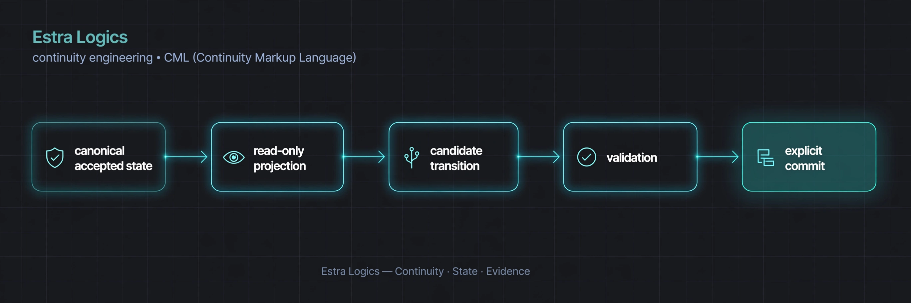

# Estra Logics — Engineering Portfolio

**Continuity engineering for stateful AI and software systems**

Engineering · Software production management · Applied research

Estra Logics is my independent engineering platform focused on continuity and integrity across changing systems. CML (Continuity Markup Language) is the underlying language and engine. Its renderer-neutral approach separates the description of accepted state and proposed changes from the system that ultimately executes or renders them.

My role spans engineering and production management for software development. I bring a practical focus to technical work: define the problem, make the change reviewable, identify what must be checked, and leave a clear record for the next person.

## Capabilities

| Capability | How it appears in the work |
| --- | --- |
| Engineering production and coordination | Defined scope, task sequencing, dependencies, blockers, decision records, and accountable handoffs. See the [workstation](WORKSTATION.md) and [journals](journals/). |
| Software investigation and regression work | Source inspection, focused patches, compatibility checks, and regression fixtures tied to a specific problem and revision. |
| Continuity and validation design | Acceptance rules, protected accepted state, revision checks, recovery paths, and independently checkable records. |
| Local-first application prototyping | Browser interfaces, local persistence, structured data, and workflows that remain understandable to the person using them. |
| Technical communication | Setup instructions, reproducible test procedures, explicit results, and concise maintainer handoffs. |

## Selected engineering work

### CML Local Alpha — preserving accepted state through change

A failed edit should not erase the last accepted document. Concurrent windows should not silently overwrite one another.

The local application combines static CML validation with atomic document storage, revision checks, accepted-state recovery, and downloadable verification receipts. Receipts can be checked offline; the current source also supports optional Ed25519 signatures.

**Engineering focus:** persistence, conflict handling, recovery, validation interfaces, and reproducibility.

**Stage:** alpha. Static document acceptance and receipt authentication have defined scopes; neither verifies external execution.

[Source and setup](https://github.com/cstolting-collab/CML-Local-Alpha) · [Receipt signing and trust](https://github.com/cstolting-collab/CML-Local-Alpha/blob/main/RECEIPT_SIGNING.md)

### CML Trust — keeping observations traceable

Evidence gathered about a system needs a durable history, including uncertainty and later revocation.

CML Trust records plan and evidence hashes, checkpoints, span reviews, and revocations in a local JSONL ledger. Observations remain separate from canonical CML state.

**Engineering focus:** evidence organization, append-only records, coverage review, and the distinction between observation and acceptance.

**Stage:** research prototype / alpha.

[Source and documentation](https://github.com/cstolting-collab/CML-Trust)

### Pattern Atlas — making records easier to examine

Scattered records are easier to review when their dates, sources, and relationships stay visible together.

Pattern Atlas provides a local-first timeline and relationship map with typed connections, source notes, filters, an explanation path, and JSON import/export.

**Engineering focus:** structured data, information design, traceable relationships, and local browser persistence.

**Stage:** browser prototype. Connections represent documented relationships; interpretation remains with the reviewer.

[Source and usage](https://github.com/cstolting-collab/pattern-atlas)

### Transparent Glasshouse — a shared surface for people and agents

An agent’s actions should be understandable in the same interface a person is using.

The Glasshouse combines a spatial React workspace with six WebMCP tools. Human controls and agent tools update shared interface state, with actions reflected in a visible activity stream. Tool inputs are constrained to the public demonstration’s content and controls.

**Engineering focus:** interaction design, bounded tool interfaces, input validation, and visible human–AI collaboration.

**Stage:** public demonstration.

[Source and demo instructions](https://github.com/cstolting-collab/transparent-glasshouse-webmcp)

## Open-source contribution example

[openai/openai-go #932 — preserve manual response history](https://github.com/openai/openai-go/pull/932)

The submitted contribution addresses ordered replay of completed response items when an application maintains its own history. It includes an SDK helper, a usage example, and regression fixtures covering unknown fields, tool output, buffer isolation, and empty output.

This illustrates focused investigation, compatibility work, regression design, and a documented maintainer handoff. The pull request records review and validation status for each revision.

## Working approach

I keep requirements, proposed changes, observed results, and open questions distinguishable. Failed attempts and corrections stay in the record so later work can use them. Human authority remains explicit at consequential decisions.

Development is human-led and AI-assisted. The [Engineering Work Record](README.md#engineering-work-record) preserves dated evidence; project documentation carries implementation scope and setup details. Upstream authorship and licenses remain intact.

## Professional availability

Open to work and contract projects in engineering production, software investigation, validation tooling, and technical documentation.

[Public project inquiries](https://github.com/cstolting-collab/CML-GitHub-Work-Record/issues/new?title=Professional%20inquiry)

---

[Engineering Work Record](README.md) · [GitHub profile](https://github.com/cstolting-collab)

**Estra Logics · Continuity · State · Evidence**
