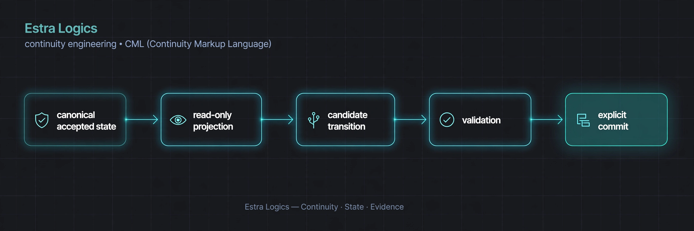

# Estra Logics · Engineering Portfolio

**Software investigation, validation tools, and engineering handoffs grounded in inspectable work.**

I'm S.J., the independent creator behind Estra Logics. My work brings together engineering and software production management: define the problem, prepare a focused correction, check the result, and leave a usable record.

[Accepted contribution](#accepted-contribution--microsoft-semantic-kernel) · [Try a project](https://github.com/cstolting-collab/ESTRA-LOGICS-V1) · [Evidence archive](README.md) · [Contact me](CONTACT.md)

## Accepted contribution — Microsoft Semantic Kernel

**[microsoft/semantic-kernel #14454](https://github.com/microsoft/semantic-kernel/pull/14454) · Merged October 27, 2026.**

| Part | What happened |
| --- | --- |
| Problem | Constrained Pydantic fields could place constraint metadata in a JSON schema description instead of the intended text, causing serialization to fail. |
| Correction | Prefer the field's description and retain compatible text or dictionary metadata fallbacks. |
| Regression coverage | The patch adds cases for a constrained field with a description and for a description carried in annotated metadata. Both exercise JSON serialization. |
| Outcome | The upstream project merged the contribution. The pull request and changed files preserve the correction, tests, and review history. |

This is a concrete example of source investigation, compatibility work, and regression design. It is evidence for that specific correction; project-wide reliability requires its own validation.

## CML Local Alpha — keep the accepted document through a failed edit

**Problem:** a failed edit should leave the last accepted document available, and concurrent windows should report conflicts rather than silently overwrite one another.

**Implementation:** local static validation, atomic document storage, revision checks, accepted-state recovery, and downloadable verification receipts.

**Try it:** load the supplied sample, validate it, remove a required lock, and validate again. The [ten-minute test](https://github.com/cstolting-collab/CML-Local-Alpha/blob/main/tester/TEST_SCRIPT_10_MIN.md) describes the expected FAIL result and preserved accepted state. It begins after setup and asks testers to record their actual results.

**Stage and limits:** alpha. Static document checks and receipt verification do not verify external execution. The published alpha.2 archive exports unsigned receipts; optional Ed25519 signing is documented for the source checkout.

[Download alpha.2](https://github.com/cstolting-collab/CML-Local-Alpha/releases/tag/v0.1.0-alpha.2) · [Setup and source](https://github.com/cstolting-collab/CML-Local-Alpha) · [Receipt signing and trust](https://github.com/cstolting-collab/CML-Local-Alpha/blob/main/RECEIPT_SIGNING.md)

## Transparent Glasshouse — make shared actions visible

*Saved preview. The hosted version currently requires ChatGPT sign-in and permission to access; public source is available for local use.*

**Problem:** a person should be able to see the interface state and actions an agent is working with.

**Implementation:** a spatial React workspace with six WebMCP tools. Human controls and agent tools use shared state, with actions reflected in an activity stream.

**Try it:** explore a Bloom Card, compose a Wonder Route, and change the room's weather. The human interface works in an ordinary browser; agent interaction requires a compatible WebMCP browser.

**Stage:** public source demonstration with restricted hosted access. This is an interface example, not evidence of general autonomous control.

[Hosted preview](https://transparent-glasshouse-webmcp.cstolting.chatgpt.site/) · [Local setup and demo sequence](https://github.com/cstolting-collab/transparent-glasshouse-webmcp)

## Further research and prototypes

| Project | Problem and implementation | Stage |
| --- | --- | --- |
| [CML Trust](https://github.com/cstolting-collab/CML-Trust) | Keep evidence and later corrections traceable through plan/evidence hashes, a local JSONL ledger, coverage review, and preserved revocations. Observations stay separate from canonical CML state. | Research prototype / alpha |
| [Pattern Atlas](https://github.com/cstolting-collab/pattern-atlas) | Review scattered records through source-noted timelines, typed relationships, filters, and JSON import/export. Connections record relationships; interpretation remains with the reviewer. | Browser prototype |

## Contribution under review

[openai/openai-go #932 — preserve manual response history](https://github.com/openai/openai-go/pull/932) addresses ordered replay of completed response items. The submitted work includes an SDK helper, usage example, and regression fixtures.

**Status checked November 10, 2026: open and unmerged.** Follow the pull request for subsequent review and validation. It is listed separately from the accepted Microsoft contribution.

## Ways I can help

| Work | Typical deliverable |
| --- | --- |
| Software investigation | Reproduction notes, a focused patch, and regression evidence |
| Validation tooling | Explicit checks, recorded results, and documented limits |
| Engineering production | Scope, dependencies, blockers, and an actionable handoff |
| Technical documentation | Setup instructions, test procedures, and concise maintainer notes |

**Estra Logics** is the platform; **CML — Continuity Markup Language —** is the underlying language and engine. **Fermata** is the working method around evidence and accountable continuation. Development is human-led and AI-assisted. Failed attempts and corrections stay in the [work record](README.md), and upstream authorship and licenses remain intact.

[Discuss a project](CONTACT.md) · [Evidence archive](README.md) · [GitHub profile](https://github.com/cstolting-collab)
