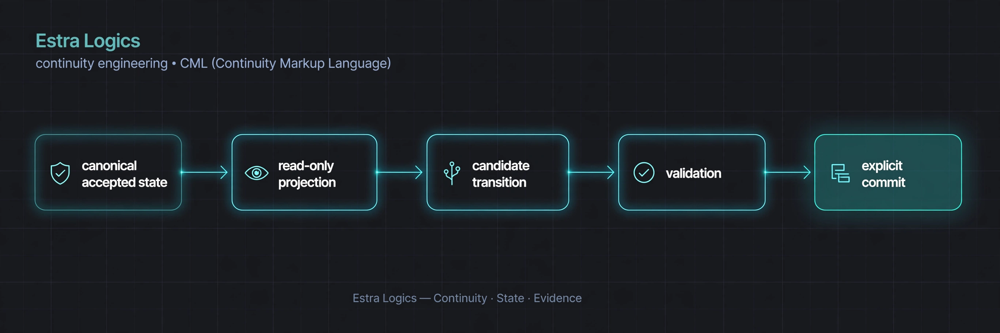

# Estra Logics · Engineering Work Record

**Evidence, corrections, and handoffs that let another person continue the work.**

This is the detailed record behind the public portfolio: dated investigations, source revisions, patch records, test results, and unresolved questions.

[Selected case studies](PUBLIC_PORTFOLIO.md) · [Project guide](https://github.com/cstolting-collab/ESTRA-LOGICS-V1) · [Public project inquiries](CONTACT.md)

## Start with the evidence

| Record | What to inspect |
| --- | --- |
| [Microsoft Semantic Kernel #14454](https://github.com/microsoft/semantic-kernel/pull/14454) | A field-description correction with regression coverage, merged upstream October 27, 2026. [Case study](PUBLIC_PORTFOLIO.md#accepted-contribution--microsoft-semantic-kernel). |
| [Dated journals](journals/) | Investigations, observations, failed attempts, corrections, and next-owner handoffs. |
| [Patch records](patches/) | Bounded changes and their supporting rationale. |
| [Engineering workstation](WORKSTATION.md) | Work coordination and continuation notes. |
| [Working standards](standards/) | Evidence and acceptance practices used in the record. |

## How to read a result

A useful result identifies the problem, the exact source revision, the check performed, the observed outcome, and what remains unresolved. A local test and an upstream merge answer different questions.

| Status | Meaning in this record |
| --- | --- |
| Observed | A source, log, or direct inspection supports the statement. |
| Locally tested | A named check ran against a specific revision in a recorded environment. |
| Submitted / under review | The correction is published for consideration; acceptance remains pending. |
| Merged upstream | The upstream project merged the contribution; follow the linked pull request for the record. |
| HOLD / blocked | A required condition is unresolved. The record names the next actor or evidence needed. |

Historical results stay attached to their dates and revisions. Follow the linked upstream source for current review and workflow status.

## Engineering work record

The original journals and patch history remain available:

- [20 October 2026](journals/2026-10-20.md) — workstation recovery and GitHub audit
- [29 September 2026](journals/2026-09-29.md) — external contribution audit and review findings
- [23 September 2026](journals/2026-09-23.md) — Codex Windows investigation and maintainer handoff
- [22 September 2026](journals/2026-09-22.md) — fork validation and benchmark evidence
- [19 September 2026](journals/2026-09-19.md) — contribution scope corrections and CI limitations

[Dated journals](journals/) · [Patch records](patches/) · [AI Source](AI_SOURCE.md)

## Project documentation

For CML Local Alpha, CML Trust, Pattern Atlas, and Transparent Glasshouse, use the [project guide](https://github.com/cstolting-collab/ESTRA-LOGICS-V1). Each repository carries its own maturity, setup, licensing, and validation details.

Development is human-led and AI-assisted. Corrections remain part of the record. CML static checks do not certify runtime behavior or safety, and upstream authorship and licenses remain intact.

[Apache License 2.0](LICENSE) for this work record; linked projects retain their own licenses.

[GitHub profile](https://github.com/cstolting-collab) · [Engineering portfolio](PUBLIC_PORTFOLIO.md) · [Discuss a project](CONTACT.md)
